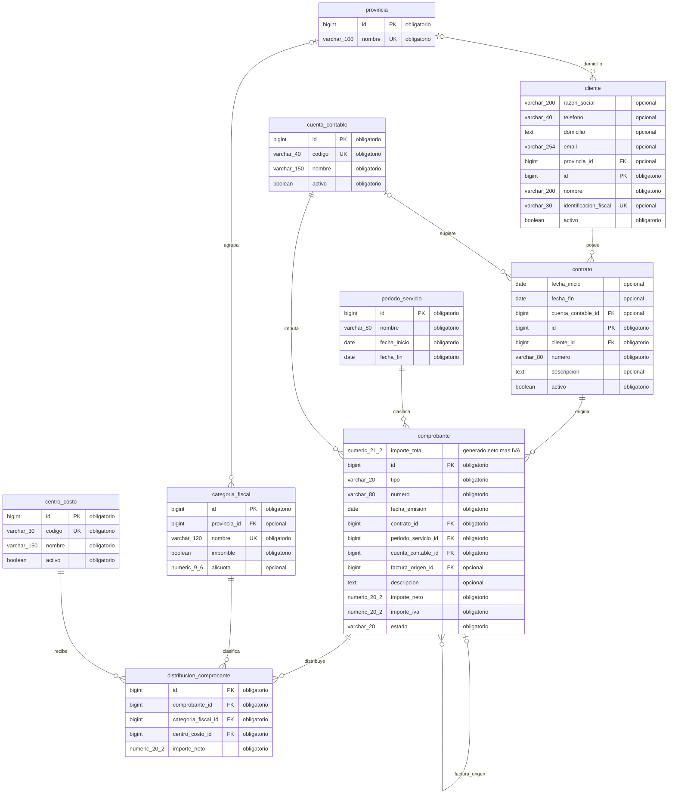

# Diagrama entidad-relación completo

[Volver al índice](../README.md)

El DER contiene las nueve tablas, los 54 campos y las once relaciones del modelo. Los tipos como `numeric_20_2` representan `numeric(20,2)`; esta notación permite leer precisión y escala en Mermaid.

## Restricciones que complementan el dibujo

- `PK` indica clave primaria; `FK`, clave foránea; `UK`, unicidad de una columna.
- Las unicidades compuestas son `contrato(cliente_id, numero)`, `comprobante(tipo, numero)` y `distribucion_comprobante(comprobante_id, categoria_fiscal_id, centro_costo_id)`. No se marca cada componente como único individualmente.
- FACTURA exige origen nulo; NC y ND exigen una FACTURA confirmada como origen y motivo obligatorio.
- Categoría imponible exige provincia. La tasa puede faltar al cargar, pero debe existir para calcular el informe tributario.
- Un borrador admite cero distribuciones; al confirmar se exige al menos una y suma igual al neto.
- La columna `importe_total` es generada por la base. Todas las FK mantienen `ON DELETE RESTRICT`.
- Los indicadores de opcionalidad no sustituyen las condiciones anteriores ni los controles transaccionales.

El [diccionario](../base-de-datos.md) detalla tipos, valores predeterminados y restricciones. La [verificación de diagramas](validacion.md) identifica los controles realizados. El [archivo Mermaid](entidad-relacion.mmd) es editable.

[Abrir DER como imagen ampliable](entidad-relacion.svg).
