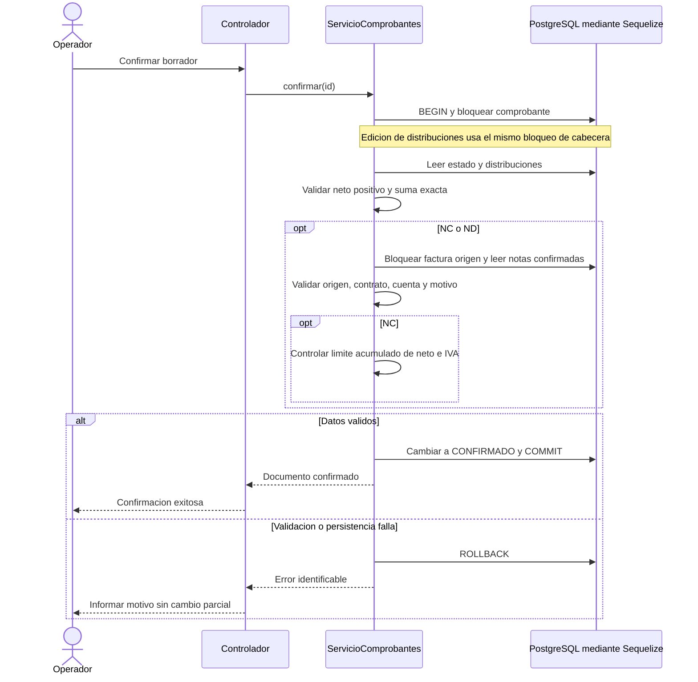
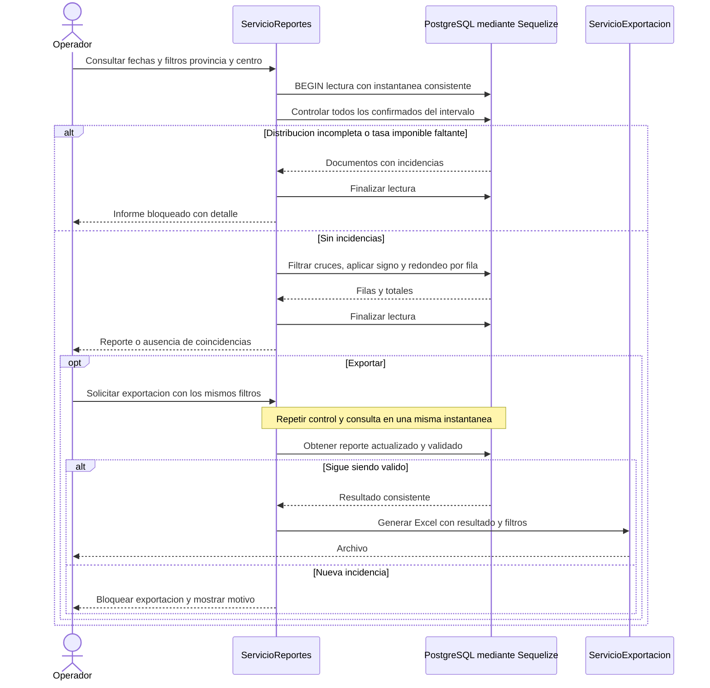
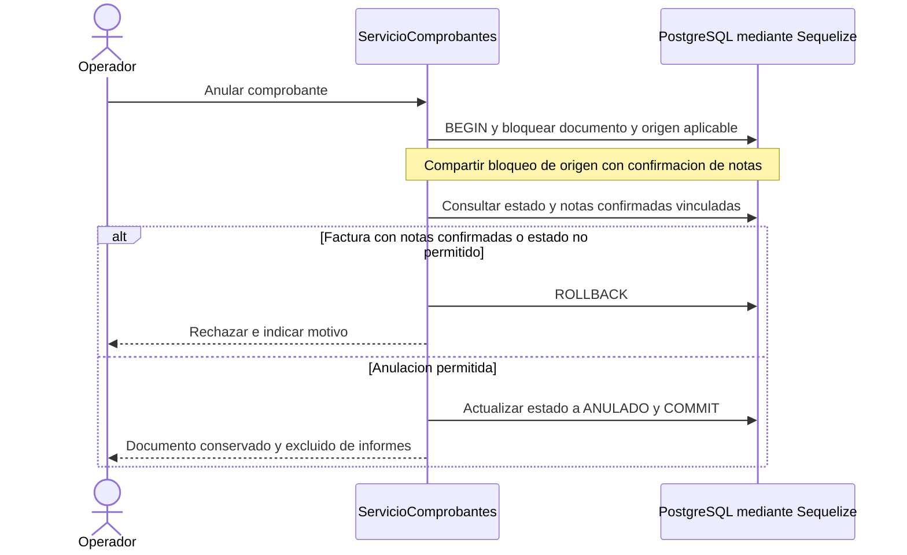

# Diagramas de secuencia de procesos críticos

[Volver al índice](../README.md)

Los diagramas describen el comportamiento propuesto del backend. Mantienen la arquitectura de controladores, servicios y modelos Sequelize, sin agregar repositorios obligatorios.

## Confirmación y límites de notas

CU01 y CU02; RF07 a RF09; RN04, RN05, RN08 y RN09.

## Informe tributario y exportación

CU04 y CU06; RF12 a RF16; RN06, RN08, RN10 y RN11.

## Anulación y notas relacionadas

CU05; RF10; RN06, RN09 y RN13.

## Condiciones de implementación

Guardar cabecera y distribuciones también es una operación atómica. Todos los caminos que editan distribuciones deben respetar el bloqueo de su comprobante; bloquear únicamente al confirmar no evita escrituras concurrentes por otro camino. El bloqueo de la factura origen serializa confirmaciones de notas y anulaciones que compiten por ella. Establecer un orden de bloqueo consistente y una política de reintento de transacciones ante interbloqueos.

Una implementación posible del informe es una transacción de lectura con aislamiento REPEATABLE READ: control y agregación observan la misma instantánea, incluidas las alícuotas. Una exportación vuelve a validar; puede diferir de una pantalla anterior si los datos cambiaron y debe indicar sus criterios. Ante un error de base o conexión se comunica fallo, no ausencia de resultados.

Los bloqueos y el aislamiento son propuestas que deben implementarse y probarse. Se deberán ejecutar pruebas de concurrencia y atomicidad sobre estos recorridos.
